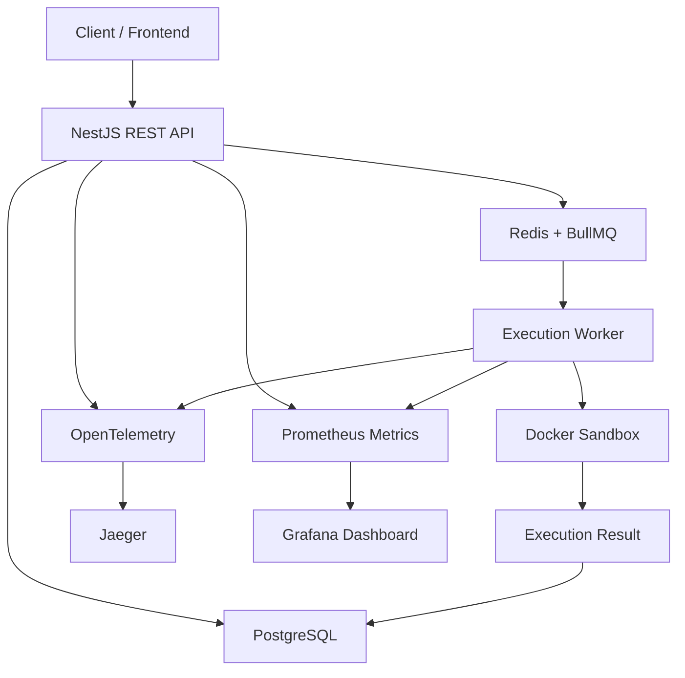

# Remote Code Execution Engine

A scalable, asynchronous code execution platform that executes user-submitted programs inside isolated Docker containers.

**Tech Stack:** NestJS · TypeScript · PostgreSQL · Redis · BullMQ · Docker · Prometheus · Grafana · OpenTelemetry · Jaeger

## Overview

Remote Code Execution Engine is a backend-focused platform that allows users to submit source code through REST APIs and execute it in isolated Docker containers.

It uses an asynchronous job-processing architecture to separate API request handling from code execution. Redis and BullMQ manage execution jobs, while dedicated workers process submissions and store execution results in PostgreSQL.

The platform also includes multi-language execution, resource restrictions, distributed tracing, metrics collection and performance monitoring.

## Key Features

- **Asynchronous Execution:** Processes code submissions through Redis and BullMQ.
- **Multi-language Support:** Executes Python, JavaScript and C++ programs.
- **Docker Sandboxing:** Runs submitted programs inside isolated containers.
- **Resource Restrictions:** CPU, memory and execution-time limits.
- **Job Lifecycle Management:** Tracks submissions through pending, running, completed and failed states.
- **Persistent Storage:** Stores submissions and execution results in PostgreSQL.
- **Distributed Tracing:** Uses OpenTelemetry and Jaeger to trace requests across the API, queue and worker.
- **Monitoring:** Uses Prometheus and Grafana to monitor system performance.
- **Load Testing:** Uses k6 to evaluate API performance and request latency.

## Architecture



## Tech Stack

| Category | Technologies |
|---|---|
| Backend | Node.js, NestJS, TypeScript |
| Database | PostgreSQL |
| ORM | TypeORM |
| Queue | Redis, BullMQ |
| Code Execution | Docker, Dockerode |
| Monitoring | Prometheus, Grafana |
| Distributed Tracing | OpenTelemetry, Jaeger |
| Load Testing | k6 |
| Testing | Jest |
| Infrastructure | Docker Compose |

## System Workflow

1. A client submits source code through the REST API.
2. The API validates the request and stores the submission in PostgreSQL.
3. A job is added to the Redis-backed BullMQ execution queue.
4. An independent worker consumes the job.
5. The worker launches a Docker container with the required language runtime and resource restrictions.
6. The submitted program executes inside the container.
7. The worker captures execution output, errors, exit status and duration.
8. The submission result is updated in PostgreSQL.
9. The client retrieves the execution result using the submission ID.

## API Endpoints

| Method | Endpoint | Description |
|---|---|---|
| POST | `/submissions` | Submit source code for execution |
| GET | `/submissions` | Retrieve submissions |
| GET | `/submissions/:id` | Retrieve a submission and its result |
| GET | `/metrics` | Expose Prometheus metrics |

## Security and Isolation

Executing untrusted code requires strict isolation and resource management.

The execution environment includes:

- Docker container isolation.
- CPU and memory restrictions.
- Execution timeouts.
- Restricted network access.
- Read-only filesystem where configured.
- Non-root container execution.
- Controlled temporary directories.
- Language and input validation.

**Security note:** Docker isolation reduces execution risk but is not a guarantee against every container escape vulnerability. Public deployment requires additional host hardening and strict access controls.

## Monitoring and Observability

The application exposes Prometheus metrics to monitor API traffic, execution workload and system performance.

**Custom Prometheus metrics:**

- `http_requests_total` — Total HTTP requests.
- `http_errors_total` — Total HTTP errors.
- `queue_depth` — Number of waiting execution jobs.
- `execution_duration_seconds` — Execution duration distribution.

**OpenTelemetry and Jaeger** provide distributed traces across the API, database, queue and worker execution flow.

**Grafana** visualizes request throughput, error rates, queue depth and execution latency.

## Performance Testing

The API was tested using k6 to evaluate request throughput and latency.

| Metric | Result |
|---|---|
| Total requests | 30 |
| Virtual users | 3 |
| p50 latency | 13.33 ms |
| p95 latency | 136.20 ms |
| p99 latency | 139.18 ms |
| Error rate | 0% (0 failed requests) |

Load test performed using k6 with 3 virtual users over 10 seconds against the GET /submissions?page=1&limit=20 endpoint.

## Local Setup

### Prerequisites

- Node.js
- npm
- Docker
- Docker Compose
- Git

### 1. Clone the repository

```bash
git clone https://github.com/abhishek9874-ctrl/remote-code-execution-engine
cd remote-code-execution-engine
```

### 2. Install dependencies

```bash
npm install
```

### 3. Configure environment variables

Create a `.env` file

Configure the PostgreSQL connection, Redis connection, execution limits and application port.

Never commit real credentials or secrets.

### 4. Start infrastructure

```bash
docker compose up -d
```

### 5. Run database migrations

Use the migration command configured in `package.json`:

```bash
npm run migration:run
```

### 6. Start the API

```bash
npm run start:dev
```

### 7. Start the execution worker

Run the worker using the project's configured worker command.

### 8. Verify the application

```bash
curl http://localhost:3000/metrics
```

Submit a program through `POST /submissions` and retrieve its result using the returned submission ID.

## Engineering Challenges

Key engineering problems addressed in this project:

- Separating HTTP request handling from long-running code execution.
- Managing asynchronous jobs and worker concurrency.
- Isolating untrusted code using Docker containers.
- Enforcing execution timeouts and resource limits.
- Handling job retries and execution failures.
- Propagating distributed trace context across asynchronous workers.
- Measuring performance using metrics and load testing.

## Future Improvements

- Worker autoscaling based on queue depth.
- Additional programming language runtimes.
- Stronger sandbox isolation.
- Enhanced test-case evaluation.
- Improved execution analytics.

## Author

**Abhishek Kumar Singh**

B.Tech — Electronics and Telecommunication Engineering

[GitHub Profile](https://github.com/abhishek9874-ctrl)

---

Built to explore distributed job processing, containerized code execution, backend architecture and system observability.
